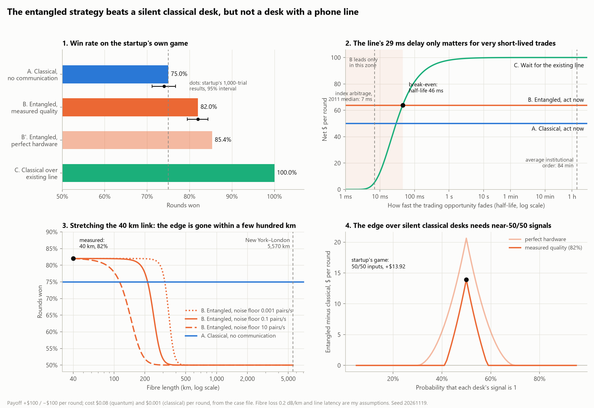

# Hackathon submission

**Challenge chosen:** 03, The Quantum Trading Edge (role: quantitative investment researcher)

## Phase 1: Investigate (written before any experiment was run)

**The commercial decision.** Whether our firm should put $3M into the startup at a $25M
pre-money valuation. The committee's question is narrower than "is the physics real": does an
82% success rate in this game turn into a service a trading firm would pay for and a
competitor could not copy.

**How I read the protocol.** It is the CHSH game. Two parties who cannot talk win with
probability at most 75% using any classical strategy, and at most cos²(π/8) ≈ 85.4% using
shared entanglement. Both of the startup's numbers sit where they should if the demo is
honest: 74% is about the classical ceiling, and 82% is below the quantum ceiling.

**Initial hypothesis.** Do not invest on these terms. I expect the physics claim to hold up
and the business claim to fail, for three reasons I can test:

1. The game forbids communication, but the customer's two desks already share a private
   low-latency line. If one desk can send its bit to the other, a classical strategy wins
   100% of rounds at $0.001. "Better than any classical strategy" is only true inside the
   no-communication rule.
2. Entanglement cannot carry information. Each desk's answer on its own is a coin flip, so
   the service cannot replace the line.
3. The result was measured on 40 km of fibre. New York to London is about 5,570 km, and
   fibre loss is exponential in distance.

**The uncertainty that matters most.** Whether any real trading decision has the game's
shape: two desks that must each commit to a binary action faster than a message can cross
between them, with a payoff that rewards agreeing except when both private signals are 1.
If that situation does not occur, the rest is irrelevant.

**Evidence that would change my mind.**

- A named trading workflow where both desks must act inside the one-way latency of their
  line (tens of milliseconds for New York to London) and the payoff has the CHSH structure.
- Entanglement delivered between the two actual cities with enough quality to beat 75%, at
  a useful rate.
- A cost per round that stays far below the edge per round at that distance.

**Experiment plan.** Compare three alternatives on the startup's own game and payoff:
(A) best classical strategy without communication, (B) the entangled strategy at the
measured quality, (C) classical strategy using the line the desks already have.

1. Enumerate all 16 deterministic classical strategies to get the classical ceiling exactly.
2. Simulate the quantum protocol in Qiskit, ideal and with noise tuned to 82%, for 1,000
   rounds, and check that neither desk's answers reveal the other's input.
3. Test whether 820/1,000 and 740/1,000 are statistically distinguishable from 75%.
4. Convert each alternative to dollars per round, and find how many rounds the $50M claim needs.
5. Stress the two things the pitch depends on: distance (40 km to 5,570 km) and the
   decision deadline relative to the line's latency.
6. Vary the input statistics to see how fragile the edge is when the trading problem is not
   exactly the textbook game.

## Phase 2: Experiment

Code: `solution/chsh_experiment.py`. Outputs: `solution/results/chsh_decision.png`,
`results.md`, `results.json`. Checks: `tests/test_chsh.py`. Seed 20261119.



### Three alternatives on the startup's own game

| Alternative | Win rate | Net $ per round | Source |
| --- | --- | --- | --- |
| A. Classical, no communication | 75.0% | 50.00 | exact: all 16 strategies enumerated |
| B. Entangled, no communication, measured quality | 82.0% | 63.92 | startup's figure; reproduced in Qiskit Aer |
| B'. Entangled, perfect hardware | 85.4% | 70.63 | exact statevector; the physical ceiling |
| C. Classical over the desks' existing line | 100.0% | 100.00 | one desk sends its bit, the other picks the winning answer |

**The result a reviewer can verify in a minute:** there are only 16 deterministic classical
strategies. Eight win 75% of rounds, eight win 25%, none do better. The entangled circuit
gives cos²(π/8) = 85.36% for every input pair. Both are asserted in `tests/test_chsh.py`.

### Is the startup's measurement believable?

- **Quantum, 820/1,000.** 95% interval 79.5% to 84.3%. The chance a classical strategy
  scores this well by luck is 7 in 100 million. The physics claim holds.
- **Classical demo, 740/1,000.** 95% interval 71.2% to 76.7%, consistent with the 75%
  ceiling (p = 0.47). The startup did not sandbag its classical baseline.
- **82% is below the 85.4% ceiling**, so it is physically possible. It implies a pair
  quality (visibility) of 0.905; anything above 0.707 beats classical.
- **1,000 trials is noisy.** My seeded 1,000-round simulations returned 76.4% (classical),
  84.8% (ideal) and 80.5% (measured quality). Over 200,000 rounds the noisy simulation
  settles at 82.1%.
- **No information is transmitted.** Over 200,000 simulated rounds, desk A answered "1"
  between 49.9% and 50.1% of the time whatever desk B's input was.

### Unit economics

Reading chosen: the "$50M annual financial opportunity" is the trading firm's gross gain
from playing with the quantum protocol, not the startup's revenue. The payoff lands at the
desks; the startup can only charge a share of the value it adds.

- $50M at $64 gross per round is **781,250 rounds a year** (about 3,100 per trading day).
  A classical strategy needs 1,000,000 rounds for the same $50M.
- At the same 781,250 rounds, a free classical strategy earns $39.06M. The quantum protocol
  therefore adds **$10.9M a year, $13.92 per round**. That is the ceiling on what the firm
  would pay.
- The existing line would earn $78.1M on the same rounds.

| Take rate (share of $50M) | Fee to startup | Firm profit | Firm $ per trade | Startup profit per trade | Startup profit |
| --- | --- | --- | --- | --- | --- |
| 10% | $5.0M | $45.0M | 57.60 | 6.32 | $4.94M |
| 20% | $10.0M | $40.0M | 51.20 | 12.72 | $9.94M |
| 30% | $15.0M | $35.0M | 44.80 | 19.12 | $14.94M |
| Classical, no fee, same trades | 0 | $39.06M | 50.00 | | |

The firm is better off with free classical once the take rate passes 21.9%. If the firm can
simply run more rounds, it reaches $50M classically for $1,000 and pays the startup nothing.

### What is the line's delay worth?

The quantum protocol competes with the line only on time: it lets both desks act now
instead of waiting about 29 ms for a message to cross.

- Waiting for the line nets $100 minus whatever the delay costs. The entangled strategy
  nets $63.92. So **the delay must cost more than $36.08 per round**, 36% of the
  opportunity, before quantum wins.
- If the opportunity fades exponentially, that means a **half-life under 46 ms**.
- Illustrative block trade: a $10M order chasing 20 basis points is a $20,000 opportunity.
  If that edge fades over 30 minutes, 29 ms of delay costs **about $0.23**, one
  hundred-thousandth of the opportunity. The block's half-life is roughly 40,000 times too
  long for the delay to matter.
- The random price move over 29 ms on that order is about $177 (one standard deviation, at
  25% annual volatility), but it is as likely to help as to hurt, so it is risk, not cost.

### Can the link reach?

- New York to London is 1,114 dB of fibre loss against 8 dB on the test link. The pair rate
  falls from 1,000 per second to about 10⁻¹⁰⁸ per second.
- With any noise floor in the range I swept, the win rate drops below 75% between 113 km
  and 312 km (panel 3). Even with no noise, the link delivers one pair an hour at 368 km.
- At 40 km, where the link works, a message takes 0.13 ms, so the line is even harder to
  beat on time.

### How robust is the edge to the game's shape?

If each desk's signal is 1 with a probability other than 50%, the edge shrinks fast. At the
measured quality it exists only when that probability is between 42% and 58% (panel 4).
Outside that range the desks do as well by ignoring the pair.

### Assumptions

| Assumption | Value | Why |
| --- | --- | --- |
| Win rates and costs | as in the case file | taken as the startup's claims; 82% and 74% checked against theory |
| Cost of using the existing line | $0 per round | the line is already paid for; the case file gives no figure. Quantum only wins if this exceeds $36.08 |
| "Classical $0.001" | cost of the no-communication demo | it is listed beside the quantum cost for the same protocol |
| Who bears $0.08 | the startup | it is selling a service on its own link |
| $50M | firm's gross gain with quantum | the payoff accrues to the desks |
| One round | one coordinated block-order decision | the startup's proposed first service |
| New York to London | 5,570 km great circle; 6,000 km fibre route; 29 ms one-way | geography and light speed in glass (index 1.47) |
| Fibre loss | 0.2 dB/km | standard telecom fibre |
| Noise | constant floor of 0.001 to 10 false pairs per second, white noise | swept over four orders of magnitude; the conclusion does not move |
| "1,000 pairs per second" | delivered rate at 40 km | the more favourable reading |
| Block trade | $10M, 20 bp edge, 30-minute half-life, 25% volatility | my illustration; the break-even half-life of 46 ms does not depend on it |
| Take rates | 10%, 20%, 30% | illustrative |

## Phase 3: Recommendation

**To:** Investment Committee. **Re:** $3M at $25M pre-money in the entangled-coordination startup.

**Recommendation: do not invest on these terms.** The physics is real. It does not create a
defensible business in the market the startup has chosen.

**What we found**

1. **The measurement is sound.** 82% over 1,000 trials cannot be explained by a classical
   strategy (odds of 7 in 100 million), and the startup's 74% classical baseline is fair.
2. **The comparison is the wrong one.** "Better than any classical strategy" holds only if
   the desks cannot talk. The customer's desks share a private line, which wins every round.
   Per round: line $100, quantum $63.92, silent classical $50.
3. **Time is the only thing the product can sell, and block orders do not need it.** Quantum
   beats the line only when a 29 ms wait destroys more than 36% of a trade's value, which
   means opportunities with a half-life under 46 ms. For an illustrative block order the
   same wait costs about 23 cents on a $20,000 opportunity.
4. **The $50M is mostly not theirs.** Read as the customer's gain, it needs 781,250 rounds a
   year, and $39M of it is available from a free classical strategy. The value added is at
   most $10.9M a year, the startup keeps a fraction of that, and only where the line cannot
   be used.
5. **The link does not reach.** The result is from 40 km. Extending the same fibre link loses
   the edge within roughly 110 to 310 km; New York to London is 5,570 km. The $0.08 per round
   excludes the cost of a transatlantic quantum link, which the startup has not shown it can
   build.
6. **The edge is fragile.** It needs the trading problem to match the game exactly,
   including near-50/50 independent signals.

**Did the initial hypothesis survive?** Yes, with one correction. I expected the line to
make the quantum protocol pointless in every case. The experiment shows a regime where that
is wrong: trades that fade within tens of milliseconds. Such trades may exist in
high-frequency trading, but that is not the block-order service the startup proposes, it
still needs the exact game payoff, and it needs a long-distance link that does not exist.
The experiment also changed how I read the $50M, from "implausible" to "mostly attributable
to something free".

**What would change the recommendation**

- A named customer workflow where the opportunity half-life is under about 46 ms and the
  payoff has this game's structure.
- Entanglement delivered between two real trading venues with pair quality above 0.71.
- The raw trial data, including whether rounds with a lost photon were counted. If they
  were dropped, 82% overstates what a desk that must answer every round would get.

**What I would do next**

- Send the startup those three requests before any further diligence spend.
- Ask what the three patents cover. If they cover the source or the link hardware, the asset
  may be worth more in markets where the absence of communication is the point and a
  certified violation is the product: secure key exchange and certified randomness. That is
  my suggestion, not something in the case file, and it would be a different investment
  at a different valuation.

## How to run

```
uv sync
uv run python solution/chsh_experiment.py
uv run python -m pytest tests/test_chsh.py
```

Runs in under a minute on a laptop. The quantum circuits are simulated on Qiskit Aer.

## How AI was used

Claude Code (Claude Fable 5.2) was used throughout, with me directing the analysis.

- **AI did:** recognised the protocol as the CHSH game, wrote the simulation, statistics,
  distance model and figure, and drafted this write-up.
- **I directed:** the unit-economics framing. I asked for the rounds implied by $50M, the
  profit per round for each strategy, the firm-versus-startup split under a take rate, who
  bears the operating cost, and a dollar value for the line's delay.
- **Where I corrected the AI:** it had applied the $0.001 classical cost to the existing
  line. That figure belongs to the no-communication demo; the line's cost is now a stated
  assumption with a break-even.
- **Where the AI corrected me:** my first equation for the rounds applied the win rate to
  the number of wins a second time.
- **Checks on the AI's output:** exact enumeration and exact statevector as baselines for
  the simulation; the simulation was not reproducible at first because the sampler ignored
  the seed, which was caught by running it twice and fixed; a sensitivity curve that went
  negative was corrected, since desks can always ignore a bad pair.

## Limitations and next steps

- The distance model is a simple one (constant noise floor, direct fibre). Satellites or
  quantum repeaters would change it, and the case file gives no evidence of either.
- The value-of-time result assumes exponential decay of the opportunity. The 36% threshold
  does not depend on that; the 46 ms half-life does.
- Line latency, the block-trade example and the take rates are my assumptions.
- The sensitivity to signal bias covers equal bias at both desks only, not correlated signals.
- Nothing was run on real quantum hardware; the 82% is the startup's number.
